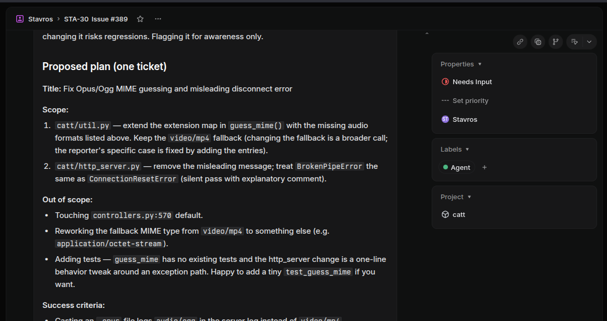

<p align="center"></p>

# Symphony

Symphony turns Linear, GitHub Projects or its own built-in web UI into the
front end for a fleet of AI coding agents. Label a ticket (or toggle a project
field, or press Start), walk away, and read the agent's reply when you have a
moment; when you reply, the agent picks the thread back up. It runs as a
single daemon on your own machine, clones each ticket's repo into its own
sandbox, hands the work to [OpenCode](https://opencode.ai/) by default (or OMP
if selected), and posts the result back as a comment.
Several tickets can be in flight at once, so you can keep planning while the
agents type.

The daemon is small and self-hosted. With Linear or GitHub your issue tracker
is the UI; the built-in backend has a small web UI of its own.

## Screenshots

<p>
  
  
</p>

## Quickstart

You need Python 3.11+, `git`, `bwrap` (bubblewrap), and OpenCode (the default)
or OMP installed and authenticated. Then:

```bash
# 1. Install
uvx symphony-linear --help

# 2. Create a workspace directory and a minimal config inside it
mkdir ~/symphony && cd ~/symphony
# For Linear:
cat > config.yaml <<'YAML'
linear:
  api_key: ${LINEAR_API_KEY}
YAML
# Or for GitHub Projects v2 (everything else has sensible defaults):
cat > config.yaml <<'YAML'
github:
  token: ${GITHUB_TOKEN}
  project: users/your-username/projects/1
YAML

# 3. Provide the bot's API key and run
export LINEAR_API_KEY=lin_api_...   # or GITHUB_TOKEN=ghp_...
uvx symphony-linear
```

That gets you a running daemon. To actually trigger work you still need to
set up your tracker: see [Linear setup](#linear-setup),
[GitHub setup](#github-setup) or [Web UI setup](#web-ui-setup).

## Installation

Symphony is published on PyPI as `symphony-linear`, and that is also the
name of the command it installs.

### With uvx (recommended)

`uvx` runs Symphony in a managed virtual environment without touching your
system Python:

```bash
uvx symphony-linear --help
```

This is convenient for casual use and for `--validate-config`. For a
long-running daemon you may prefer to install it once rather than have
`uvx` resolve the environment on every start:

```bash
uv tool install symphony-linear
symphony-linear --help
```

### With pip

If you don't have `uv`, plain `pip` works:

```bash
pip install symphony-linear
symphony-linear --help
```

Use `pipx` or a virtualenv if you'd rather not install into your system
Python.

### From source

```bash
git clone https://github.com/skorokithakis/symphony.git
cd symphony
uv sync
.venv/bin/symphony-linear --help
```

### Runtime dependencies

These are not Python packages and won't be installed for you:

- **bwrap** (bubblewrap): `apt install bubblewrap`, `dnf install bubblewrap`,
  or `pacman -S bubblewrap`.
- **git**, configured well enough to clone the repos you want the agent to
  work on.
- **OpenCode** (the default; V2 only, V1 is unsupported) or **OMP**, installed and authenticated. The
  daemon invokes the selected `opencode` or `omp` binary inside the sandbox;
  it must be on the sandbox's `$PATH`. By default the sandbox uses the
  daemon's `$PATH`; set `SYMPHONY_SANDBOX_PATH` to use a different one, for
  example under `systemd`.

## Linear setup

This is the one-off plumbing that connects Symphony to your Linear workspace.
You do it once per workspace, plus a small per-repo step for each project
you want the agent to touch.

### Generate a Personal API key

Sign into Linear with the account you want the daemon to use. This can be
your own user account or a dedicated bot account — the daemon recognises its
own comments by a hidden sentinel, not by user identity, so a separate bot
user is optional. Open **Settings** → **API** → **Personal API keys**,
create a key, and keep it somewhere safe; this is the value you'll supply
as `LINEAR_API_KEY`.

### Add a "Needs Input" workflow state

In your team's workflow settings, add a state called **Needs Input**.
Symphony moves tickets here when it finishes a turn and is waiting for you
to reply. You can rename this state later; the name lives in `config.yaml`.

### Create the trigger label

By default, add a label called **Agent** to the team. Any ticket carrying this
label becomes eligible for the agent, and the label name is configurable.

This is optional: set `linear.trigger_label: null` to skip creating a trigger
label. In that mode, a ticket is eligible when it is in a configured active
state and its project has a **Repo** external link.

### Optional: a QA workflow state

If you'd like to manually exercise the agent's work, for instance by
clicking around a running web app, add a workflow state called **QA**, point
`linear.qa_state` at it in your config, and add a `.symphony/serve` script
to your repo. When you drop a ticket into that state the daemon runs your
serve script inside the sandbox. Details under [Manual QA](#manual-qa).

### Per-repo: attach a Repo link

For each repository you want Symphony to work on:

1. Create a Linear project. Any team project will do; Symphony only uses it
   to find the repo URL.
2. In that project, open **Resources** and add a link with title `Repo`
   (case-insensitive) and the GitHub URL as the URL, for example
   `https://github.com/you/your-project`.

That link is how the daemon discovers which repo belongs to which ticket.

## GitHub setup

This is the one-off plumbing to connect Symphony to a GitHub project. You do
it once per project. The daemon uses the GitHub Projects v2 (beta) API; the
older Projects v1 is not supported.

### Token

The daemon needs a token with read/write access to Issues, Projects, and
read access to repository Contents.  This token can belong to your own
GitHub account or to a dedicated bot account — the daemon recognises its
own comments by a hidden sentinel, so a separate bot user is optional.
Add the token owner as a collaborator (with at least read access) to
every repository the daemon should clone.

- **Classic personal access token.** Enable the `repo` and `project`
  scopes.
- **Fine-grained personal access token.** Grant read/write on Issues,
  read/write on Projects, and read on Contents for the repositories.
- **GitHub App** with equivalent permissions.

Supply the token as `GITHUB_TOKEN` in the environment, or put it directly
under `github.token` in your config. When the config field is empty or
absent the daemon falls back to the `GITHUB_TOKEN` environment variable.

### Create a project

Create a GitHub Projects v2 project on your user or organization account.
Note its reference in the format `orgs/<org>/projects/<number>` or
`users/<user>/projects/<number>`. That string goes into `github.project`
in your config — for example:

```yaml
github:
  project: users/my-username/projects/1
  # or: orgs/my-org/projects/1
```

### Configure Status

Every GitHub project starts with a built-in single-select field called
`Status`. The daemon expects this field to exist (it does by default on
every new project) and will auto-create any missing options on it at
startup — just set the option names you want in `github.in_progress_status`,
`github.needs_input_status`, and optionally `github.qa_status`, and the
daemon handles the rest.

If your project uses a custom Status field with a different name, set
`github.status_field` to that name.

### The Symphony trigger field

On startup the daemon auto-creates a single-select field called `Symphony`
on the project (configurable via `github.trigger_field`). It comes with
one option, `on`.

- To **trigger** an issue: set its `Symphony` field to `on`. The daemon
  picks it up on the next poll and starts working.
- To **untick** an issue: set the field to empty, or remove the item from
  the project entirely.

Untriggering or moving the issue out of an active Status causes Symphony
to cancel any in-flight subprocesses, delete the workspace, and remove
the issue from its internal state on the next poll tick — just like
removing the trigger label on Linear. If the workspace has uncommitted
or unpushed work, Symphony refuses to delete it: it posts a comment and
moves the ticket back to Needs Input, and only deletes the workspace if
you move the ticket out a second time (or once the workspace is clean).

### Multi-repo projects

GitHub Projects v2 can contain items from any repository that the project
references. Each issue remembers its own repository; Symphony clones from
that repo's URL. By default it uses the SSH URL (`git@github.com:...`).

### Clone protocol

Set `github.clone_protocol` to `https` to clone via HTTPS instead of SSH.
This is useful when your organisation enforces MFA and SSH is not practical.

```yaml
github:
  token: ${GITHUB_TOKEN}
  project: orgs/my-org/projects/1
  clone_protocol: https
```

HTTPS cloning requires the operator to have git credentials set up on the
host (e.g. via `gh auth login` or a credential helper), because clone runs
outside the sandbox with the daemon user's identity.

The default is `ssh`; omit the field to keep the current behaviour.

### Identifier convention

Symphony uses `<owner>-<repo>-<number>-<hash>` as the identifier for GitHub
issues — for example `my-org-my-repo-42-bcc89b7f`. This appears in workspace
directory names and metadata comments, and is used to derive the branch
name when `auto_branch` is enabled.

The trailing hash is a short digest of `owner/repo`. It is there because
flattening the slash would otherwise let two different repositories collide:
`foo-bar/baz` and `foo/bar-baz` both shorten to `foo-bar-baz`, and since a
project can span repositories, both issues could be live at once and would
then share a workspace directory.

## Web UI setup

Symphony can also be its own tracker. With the `webui:` block there is no
Linear or GitHub account involved: tickets are stored as JSON files under
`<workspace>/tickets/`, and a small web UI served by the daemon is the front
end.

Exactly one backend is active per daemon. Web UI tickets are not visible in
Linear or GitHub, and Linear or GitHub tickets are not visible in the web UI.
To use the web UI beside an existing Linear or GitHub daemon, run a second
daemon with its own workspace directory and its own port.

```yaml
webui:
  port: 8080
  host: 127.0.0.1          # default
  username: admin
  password: change-me
  # Optional. Enables automatic titles (see Titles below).
  # anthropic_api_key: ${ANTHROPIC_API_KEY}
  # Optional. Base URL for the Messages API, e.g. an Anthropic-compatible
  # gateway (see Titles below).
  # anthropic_base_url: https://anthropic-gateway.example.com
  # Optional. Public base URL of this UI. A notification taps through to it
  # (see Notifications below).
  # public_url: https://symphony.example.com
  # Optional. Push notifications when a ticket needs input (see
  # Notifications below).
  # ntfy:
  #   url: https://ntfy.sh/my-symphony-topic
  #   token: ${NTFY_TOKEN}
```

Open `http://127.0.0.1:8080/`. The browser asks for the username and password
once, using HTTP Basic auth; there is no login page.

**Put HTTPS in front of the port before exposing it.** Basic auth sends the
password with every request, so plain HTTP is only reasonable on localhost.
Keep `host` on `127.0.0.1` and terminate TLS in a reverse proxy (nginx, Caddy,
Traefik, and so on).

The proxy must forward the original `Host` header: the server's same-origin
check compares it with the browser's `Origin`. Caddy and Traefik do this by
default; with nginx, set `proxy_set_header Host $http_host` (not `$host`,
which drops a non-default port and breaks every write) and
`proxy_set_header X-Forwarded-Proto $scheme` next to it, so the daemon knows
the browser is on TLS. `X-Forwarded-Proto: https` tells it to refuse posts
that come from the plain-http origin of the same host name. No other
forwarded header is trusted.

A proxy login service that adds Basic credentials after its own login works
without any Symphony change. For example, Tinyauth can inject an
`Authorization: Basic ...` header from its `basic-auth` response labels, and
the daemon sees an ordinary authenticated request.

### Tickets and states

Tickets are in one of five fixed states:

| State | What it means | Actions |
|---|---|---|
| Draft | an idea in the editor; nothing has run | Start, Discard |
| In Progress | the agent is working | Stop |
| Needs Input | the agent has replied and is waiting for you | Send, Send to QA, Done |
| QA | your `.symphony/serve` script is running | Send, Back to Needs Input, Done |
| Done | finished and archived | Reopen |

- **Start** validates the editor and moves the Draft to In Progress. The
  daemon picks it up on the next poll tick. Start requires the ticket text and
  a repository; a title too, unless automatic titles are enabled.
- **Send** posts the composer's text as a human comment and wakes the daemon.
  It does not change the state itself: the daemon resumes the session on the
  next tick and moves the ticket to In Progress, exactly as it does for a
  comment on Linear or GitHub.
- **Stop** moves an In Progress ticket back to Needs Input. Any in-flight turn
  is killed on the next tick.
- **Send to QA** moves a Needs Input ticket to QA without posting the composer
  text. If the repo has a `.symphony/serve` script, the daemon starts it, as
  described under [Manual QA](#manual-qa); QA is always enabled for this
  backend.
- **Done** stops tracking the ticket and deletes its workspace. If the
  workspace has uncommitted or unpushed work, the daemon refuses the first
  time: it posts a comment telling you what is at risk and moves the ticket
  back to Needs Input. Moving it to Done a second time deletes the workspace.
- **Reopen** moves a Done ticket back to work. If the daemon still tracks the
  ticket, it goes to Needs Input, so a reply resumes the session through the
  normal path. If it does not (the cleanup tick already ran), it goes to In
  Progress: the daemon's new-ticket pipeline picks it up and itself ends in
  Needs Input, with or without a session snapshot. On that path Send is
  unavailable until the first turn ends.
- **Discard** deletes a Draft, its text and its uploaded files. Its number is
  never reused.

The editor autosaves a Draft on the server as you type. A ticket only comes
into existence once the editor has some content or a file is attached, so an
abandoned empty form leaves nothing behind.

### Reply composer

Every started ticket except a Done one has a reply box. It stays editable while
the agent works, and its text is saved on the server, so a reload or another
device sees the same draft. Only Send is unavailable while the ticket is In
Progress; the page says so next to the disabled button and re-enables it when
the turn finishes. In QA, sending resumes the agent, which pulls the ticket out
of QA and stops the serve on the next tick.

### Repositories

The editor's Repository field is a dropdown of the repositories you have
stored, managed from the **Repositories** page (`/repos`, also linked from the
editor). Each entry has a name and a clone URL; the ticket stores the URL
exactly as before, and the name is only what the dropdown shows. On a new
ticket the dropdown starts at the repository of the most recent ticket that is
still in the list, or at the first entry.

To add one while writing a ticket, choose **Add a repository…** and type the
URL (and optionally a name); Start adds it to the list. Saving or autosaving
the Draft only stores the URL on the ticket, so the list is never filled with
the partial URLs typed along the way; on reload the Draft shows its repository
as an extra option. Removing an entry from `/repos` never changes tickets that
already use it. The list is stored in `<workspace>/tickets/repos.json`, so the
sandbox's workspace masking keeps it out of the agent's reach.

### Models

The editor's Model dropdown lists the aliases under the top-level `models:`
map. What you pick is stored on the ticket and presented to the orchestrator
as a `Model: <alias>` label, so the usual model resolution applies (see
[Model override](#model-override)). Choosing "Default" uses the agent's own
default. The editor only edits Drafts, so the model cannot be changed after
Start.

### Attachments

The editor and the reply box accept any file type, up to 50 MB each. PNG,
JPEG, GIF and WebP files are passed to the agent as image input. Every other
file is downloaded into the ticket's `attachments/` directory, which the
sandbox sees at `/tmp/symphony-attachments`, and the agent opens it with its
own tools. The daemon's existing per-message total of 50 MB applies: uploads
beyond it are skipped and the daemon posts a "skipped attachments" comment
naming them.

Only the four image types are ever served inline. Every other upload downloads
as an attachment; an HTML or SVG file served inline from the UI's origin would
run with your credentials.

### Titles

With `webui.anthropic_api_key` set, the editor hides the Title field. Start
stores an empty title and asks the Anthropic Messages API for one in the
background, using a model id fixed in `symphony_linear/webui/title.py`. Until
it arrives, and if the request fails, the first line of the ticket text is
shown as the title. Nothing is retried and no error is shown; the fallback just
stays.

Without the key, the editor shows the Title field and Start refuses an empty
one.

`webui.anthropic_base_url` points that request at an Anthropic-compatible
gateway or proxy instead of `https://api.anthropic.com`. It takes the same
form as the SDK's `ANTHROPIC_BASE_URL`: everything before `/v1`, since
`/v1/messages` is always appended. The gateway must accept the `x-api-key`
header and the fixed model id. The key is still the on/off switch; setting
only the base URL does nothing.

### Notifications

With an optional `webui.ntfy` block, the daemon publishes one
[ntfy](https://ntfy.sh) notification each time a ticket actually changes to
Needs Input on the daemon's initiative: when a turn ends, when a turn fails,
when a cleanup is refused because the workspace has uncommitted changes, and
when a QA serve dies. Only those daemon-driven transitions notify: moving a
ticket to Needs Input yourself with the web UI's Stop or Needs Input action
sends nothing, and neither does a transition that changes nothing (a ticket
already in Needs Input).

```yaml
webui:
  # ... the rest of the webui block
  public_url: https://symphony.example.com   # optional
  ntfy:
    url: https://ntfy.sh/my-symphony-topic
    token: ${NTFY_TOKEN}               # optional, for a protected topic
```

`url` is the full topic URL; publishing uses ntfy's JSON API against the
server root, so a self-hosted server behind a path prefix works too. `token`
is sent as `Authorization: Bearer`. With `webui.public_url` set, tapping the
notification opens `<public_url>/tickets/<ticket-id>` in this web UI, which is
only useful if the UI is reachable at that address. Every notification
includes the URL of the Symphony icon on the `master` branch of the Symphony
GitHub repository, because the UI itself requires Basic auth and ntfy does not
send credentials. ntfy shows the icon on Android only; on iOS the
notification arrives without one.

Of the ticket's content, the notification carries only the identifier and
title (for example `SYM-4: Fix the frobnicator`). Comment and reply text is
deliberately never sent: it does not exist at the moment of the transition,
and it would go to a third party. Delivery is best-effort: a failure is one
WARNING in the daemon log, with a short timeout, and never affects the turn.

## Configuration

Symphony reads `config.yaml` from its workspace directory, which defaults to
the current working directory and can be overridden with `--workspace`. The
daemon refuses to start without a valid config; validate it any time with
`symphony-linear --validate-config`.

### Minimal config

For Linear:

```yaml
linear:
  api_key: ${LINEAR_API_KEY}
```

For GitHub:

```yaml
github:
  token: ${GITHUB_TOKEN}
  project: users/your-username/projects/1
  # Optional: enable manual QA by uncommenting.
  # qa_status: QA
```

For the built-in web UI:

```yaml
webui:
  port: 8080
  username: admin
  password: change-me
```

For Linear or GitHub, you can omit the credential entirely and let the daemon
read the appropriate environment variable (`LINEAR_API_KEY` or
`GITHUB_TOKEN`) directly; that is often nicer for systemd or secret managers.

### Coding agent

The optional top-level `agent` key selects the coding-agent CLI for the
daemon. It accepts `opencode` (the default), `omp`, or `pi`:

```yaml
agent: omp
```

The selected binary (`opencode`, `omp`, or `pi`) must be on the sandbox's
`$PATH`. The sandbox uses `SYMPHONY_SANDBOX_PATH` when it is set, otherwise it
uses the daemon's `$PATH`. Agents do not share sessions: changing `agent` makes
a ticket with a session from a different agent start a fresh session on its next
turn instead of resuming the old one.

`pi` keeps credentials in `~/.pi/agent/auth.json`, a separate vault from OMP's:
authenticating OMP does not authenticate pi.

### Full annotated config

The annotated config below shows the Linear backend. The GitHub and `webui`
blocks are also documented in `config.yaml.example` in the repo root, side by
side.

```yaml
# config.yaml (placed in the workspace directory)

# Coding-agent CLI to run (default: opencode). Must be `opencode`, `omp`, or `pi`.
agent: opencode

# Choose exactly one backend — linear, github or webui.
linear:
  # REQUIRED. Linear Personal API key.
  # Use ${LINEAR_API_KEY} to read from the environment, or omit this field
  # entirely and the daemon will fall back to the LINEAR_API_KEY env var.
  # The key can belong to your own account or a dedicated bot account.
  api_key: ${LINEAR_API_KEY}

  # Name of the label that triggers the bot (default: Agent). Set to null to
  # use active workflow states plus a project's Repo external link instead.
  trigger_label: Agent

  # Workflow state set while the AI is working (default: In Progress).
  in_progress_state: In Progress

  # Workflow state set while waiting for human reply (default: Needs Input).
  needs_input_state: Needs Input

  # Optional. Workflow state that enables manual QA. When a ticket enters
  # this state the daemon runs the repo's .symphony/serve script inside the
  # sandbox. Only one serve runs globally; the newest entrant wins. Omit to
  # disable the feature entirely.
  # qa_state: QA

# Built-in tracker and web UI. Comment out `linear:` above and uncomment this
# block to use it instead. See "Web UI setup".
# webui:
#   # REQUIRED. Port the web UI listens on.
#   port: 8080
#   # Bind address (default: 127.0.0.1).
#   host: 127.0.0.1
#   # REQUIRED. HTTP Basic auth credentials. There is no login page.
#   username: admin
#   password: change-me
#   # Optional. Anthropic API key for automatic ticket titles.
#   # anthropic_api_key: ${ANTHROPIC_API_KEY}
#   # Optional. Messages API base URL, e.g. an Anthropic-compatible gateway.
#   # anthropic_base_url: https://anthropic-gateway.example.com
#   # Optional. Public base URL of this UI, so a notification taps through to
#   # <public_url>/tickets/<id>.
#   # public_url: https://symphony.example.com
#   # Optional. ntfy notifications when a ticket moves to Needs Input.
#   # ntfy:
#   #   url: https://ntfy.sh/my-symphony-topic
#   #   token: ${NTFY_TOKEN}

# Optional. Model overrides for the primary agent, keyed by alias. See
# "Model override" below.
# models:
#   Strong: anthropic/claude-opus-5
#   Cheap: openai/gpt-5-mini

sandbox:
  # Paths to conceal from the agent inside the sandbox. Directories become
  # an empty tmpfs; files and sockets are replaced with /dev/null. ~ and
  # symlinks are expanded.
  hide_paths:
    - ~/.ssh
    - ~/.gnupg
    - ~/.aws
    - ~/.config/gcloud
    - ~/.netrc
    - ~/.docker
    - /run/docker.sock

  # Optional. Extra host paths bound read-write into the sandbox.
  # Missing paths cause a fatal error. Applied before hide_paths, so hiding
  # still wins in case of collision.
  # WARNING: these bypass the read-only host root mount.
  # extra_rw_paths:
  #   - ~/projects/shared-tools

  # Optional. Map a path inside the sandbox to a host directory (key =
  # sandbox path, value = host source). Relative values resolve under the
  # ticket's mounts/ directory and are deleted with the ticket; absolute
  # values are shared host directories that survive ticket cleanup. Both
  # sides are created on the host. Binds apply after hide_paths, so an
  # explicit mapping can punch through a broad hide. That includes the
  # masking of the daemon's own workspace directory: if an absolute value
  # is the workspace root, or any parent of it such as your home directory,
  # config.yaml becomes readable inside the sandbox. The daemon warns at
  # startup when that happens but does not stop you, because there are
  # legitimate reasons to want it.
  # CAUTION: a shared absolute directory is used by up to 5 concurrent
  # ticket workers — not every tool tolerates that.
  # dir_map:
  #   ~/.config/npm: npm
  #   ~/.npm: ~/sandboxes/caches/.npm

  # Optional. Directory of per-repo secrets files, one KEY=value file per
  # repo at <secrets_dir>/<host>/<owner>/<name>.env. Defaults to
  # <workspace>/secrets. See "Secrets" below.
  # secrets_dir: ~/symphony-secrets

# Seconds between poll cycles (default: 30, minimum: 1).
poll_interval_seconds: 30

# Max seconds per AI turn before the process is killed (default: 1800).
turn_timeout_seconds: 1800

# Max seconds an AI turn may go without producing any output on stdout or
# stderr before the process is killed (default: 1200). This is the idle
# watchdog: a stalled turn is killed long before the absolute cap above, and
# the failure comment says which limit fired ('produced no output for Ns'
# vs 'exceeded Ns in total'). Global only — there is no per-project override.
turn_idle_timeout_seconds: 1200
```

A copy of this example lives at `config.yaml.example` in the repo root.

### Model override

A `Model: <value>` label picks the model for a ticket's primary agent. The
daemon passes `--model` to the selected coding agent on every turn for that
ticket, first turn and resumes alike. Subagents keep their own models.

The label is read from the issue first, then from the issue's Linear project,
so the precedence is **issue label > project label > the agent's own
default**. A `Model:` label on a project is therefore a default for every
issue in it, and an issue label overrides that default one ticket at a time.

The value is looked up case-insensitively in the top-level `models` map:

```yaml
models:
  Strong: anthropic/claude-opus-5
  Cheap: openai/gpt-5-mini
```

Each entry must be a full `provider/model` id. A bare model name is
rejected at startup, since OpenCode reads everything before the first `/`
as the provider.

A value that is not in the map is used verbatim, so a raw provider/model id
works with no config change:

- `Model: Strong` → `--model anthropic/claude-opus-5`
- `Model: anthropic/claude-sonnet-4-6` → `--model anthropic/claude-sonnet-4-6`

On Linear each alias is created for you at startup — once as an issue label
and once as a project label. In label-triggered configurations, this happens
alongside the trigger label, which is only ever an issue label. Linear keeps
issue labels and project labels in two unrelated namespaces (`IssueLabel` and
`ProjectLabel`), and neither can be applied where the other belongs. Nothing
records what was already created, so the
daemon re-checks both namespaces on every start — two API calls per
configured alias.

The labels must be flat and named exactly `Model: <alias>`. A Linear label
*group* named `Model` with children such as `Strong` does not work: the API
reports only the child's own name, which carries no `Model:` prefix. The
provisioned labels are flat, so this only comes up if you hand-create a
group.

On GitHub there is no project tier. GitHub Projects v2 has no project labels
at all — `ProjectV2` has no `labels` field and does not implement
`Labelable` — so a GitHub deployment has the per-issue label and the agent's
own default, with nothing in between. GitHub issue labels are also
per-repository, so create them yourself in each repo.

Nothing is persisted. The model is resolved fresh from the polled issue on
every turn, so changing or removing either label takes effect on the next
turn. The final comment's footer reports the effective model as
`· model: <id>`; it does not say which tier it came from. Model ids are not
validated: a bad value makes the selected agent exit at once, and the ticket
lands in Needs Input with the error.

### Webhook (optional)

A webhook receiver cuts poll latency from up to `poll_interval_seconds` to
~1 second; polling continues as a safety net. The feature is opt-in — omit the
`webhook:` block to stay on polling only.

```yaml
webhook:
  port: 8080
  linear_secret: ${WEBHOOK_SECRET}
```

`linear_secret` is the HMAC-SHA256 signing secret. If the field is absent or
empty the daemon falls back to the `SYMPHONY_LINEAR_WEBHOOK_SECRET` environment
variable.

In Linear's UI: **Settings** → **API** → **Webhooks** → **Create webhook**.
Set the URL to `http://<your-host>:<port>/webhooks/linear/`, paste the same
signing secret, and subscribe to **Issue** and **Comment** events.

Symphony does not do TLS. Terminate TLS upstream (nginx, Caddy, Cloudflare)
if exposing the port publicly. Linear can deliver to either plain HTTP or
HTTPS, but production deployments should use HTTPS.

## Running

```bash
symphony-linear
```

Symphony runs in the foreground and logs to stderr. For interactive use it
is fine to start it in `tmux` or `screen`; for anything more permanent a
`systemd --user` unit is the obvious home.

A starting point for `~/.config/systemd/user/symphony.service`:

```ini
[Unit]
Description=Symphony Linear daemon
After=network-online.target

[Service]
Type=simple
WorkingDirectory=%h/symphony
# No API key here. Keep it in config.yaml in the WorkingDirectory above —
# see "Where to keep credentials" below for why.
# systemd strips PATH. SYMPHONY_SANDBOX_PATH tells the sandbox (and startup
# validation) where to find the selected coding agent and anything your
# .symphony/setup script calls. Include %h/.local/bin if your setup script uses
# tools installed there, such as uv or uvx.
Environment=SYMPHONY_SANDBOX_PATH=%h/.local/bin:%h/.opencode/bin:/usr/local/bin:/usr/bin:/bin
# The daemon itself runs bwrap and git outside the sandbox, so those must be on
# the daemon's own PATH. Add a plain Environment=PATH= line if they live
# somewhere systemd's default does not cover.
# Point at your SSH agent, or every clone of a private repo over SSH fails
# with "Permission denied (publickey)". A systemd unit inherits nothing from
# your shell. Use %t/gcr/ssh for gnome-keyring, %t/openssh_agent for a plain
# ssh-agent. Drop this line if you clone over HTTPS with a token.
Environment=SSH_AUTH_SOCK=%t/gcr/ssh
ExecStart=%h/.local/bin/symphony-linear
Restart=on-failure

[Install]
WantedBy=default.target
```

Then `systemctl --user daemon-reload && systemctl --user enable --now symphony`.

#### Where to keep credentials

The rule: the literal key should only ever be written into a file the agent
cannot read. Earlier versions of this file suggested
`Environment=LINEAR_API_KEY=lin_api_...` in the unit. Don't do that.

The coding agent reads files as you, and the sandbox masks the workspace
directory but not `~/.config`, which it should be able to read for other
reasons. So the same key is unreadable in `config.yaml` and readable in a
systemd unit.

Two options that satisfy the rule. Put the value in `config.yaml` in the
workspace directory, which is masked. Or keep using the environment
variables and load them with `EnvironmentFile=`, pointing at a file in the
workspace directory so the masking covers it too. The daemon's own
environment is never passed into the sandbox, so either is fine.

`${LINEAR_API_KEY}` in `config.yaml`, as used in the examples above, is a
reference rather than a value, so it is safe wherever it appears. What
matters is where the value it resolves to is stored.

Two variables in that sample cause most deployment failures, because both
work by accident when you launch Symphony from a terminal and stop working
under systemd:

- `SYMPHONY_SANDBOX_PATH` is the `PATH` inside the sandbox, and the one the
  startup check searches for the selected coding agent. If it omits that agent,
  the daemon refuses to start. If it omits a directory that `.symphony/setup`
  needs, the setup step exits with code 127 and a `command not found` message.
  It does not affect `bwrap` or `git`, which the daemon runs outside the
  sandbox using its own `PATH`.
- `SSH_AUTH_SOCK` is needed because Symphony clones project repos outside
  the sandbox with your credentials.

Other setup and SSH-agent failures appear later, on the first ticket.

By default the unit starts when you log in. To start it at boot instead,
run `loginctl enable-linger $USER`. Note that a lingering service starts
before you unlock your keyring, so an agent-based `SSH_AUTH_SOCK` is not
ready yet at that point.

#### Auto-restart on checkout changes

When the daemon runs from a git checkout — an editable install or
`uv run symphony-linear` — it notices when that checkout's `HEAD` moves
(`git pull`, `jj new`, `jj rebase`, ...) and restarts itself in place so new
work runs the new code. It checks only between poll ticks and waits until no
ticket is being worked on, so a running turn is never cut short. Before
re-execing it runs `--validate-config` in a fresh interpreter; if that fails it
logs the error and keeps running the old code until `HEAD` moves again.

Uncommitted edits do not trigger a restart: they do not move `HEAD`, by
design. This is a development convenience, not a deployment mechanism. It
requires running from a git checkout where the package itself is tracked (an
editable install or `uv run`). A wheel/site-packages install is not a tracked
checkout — including one installed into the repository's own `.venv` — so the
feature is off.

The restart uses `os.execv`, so it keeps the same PID — systemd (and anything
else supervising the process) needs no changes.

### Flags

| Flag                 | Effect                                                              |
|----------------------|---------------------------------------------------------------------|
| `--debug`            | Enable DEBUG-level logging.                                         |
| `--workspace <path>` | Override workspace directory (default: current working directory).  |
| `--validate-config`  | Load and validate the config, then exit.                            |

### Startup behaviour

On launch the daemon recovers any orphan tickets it was working on when it
last stopped. It posts a recovery comment and parks the ticket in the
needs-input state so you can decide whether to retry. State is persisted at
`<workspace>/state.json` and rewritten atomically.

### Graceful shutdown

`SIGINT` (Ctrl+C) or `SIGTERM` triggers a clean shutdown: in-flight
subprocesses are killed, state is persisted, and the daemon exits.

## How it works

Every `poll_interval_seconds`, Symphony queries the configured tracker for
tickets that carry the trigger signal and live in one of the active workflow
states. New tickets enter the **initial pipeline**:

1. Find the ticket's git URL: the `Repo` link on its Linear or GitHub project,
   or the repository field on a web UI ticket.
2. Clone or update the repo into
   `<workspace>/<sanitised-identifier>/repo`.
3. Switch to the ticket's branch, creating one if needed. If
   `auto_branch: false` is set, the workspace stays on whatever `git clone`
   produced (typically the remote default branch).
4. Run `.symphony/setup` inside the sandbox, if your repo has one.
5. Launch the configured coding agent inside the sandbox with the ticket's
   title and description as the prompt.
6. Post the agent's final message as a comment, plus a small metadata
   comment with the workspace path and agent session id.
7. Transition the ticket to the configured needs-input state.

Tickets you've already replied to enter the **resume pipeline** instead:
the daemon picks up the new human comments, resumes the configured agent's
session, and posts the result.

Up to five turns run in parallel across different tickets, with per-ticket
serialisation so a single ticket never has two turns in flight. The agent
and you only ever communicate through tracker comments; the daemon has no
other channel.

### Sandbox

Each coding-agent turn runs inside a bubblewrap sandbox. The ticket's workspace
is mounted read-write; the rest of the host root is read-only. Credential
directories such as `~/.ssh`, `~/.gnupg`, `~/.aws`, the Docker socket and a
handful of others are concealed by overlaying empty tmpfs or `/dev/null`.
The network namespace is shared so the agent can reach the internet, but
user, PID, IPC and UTS namespaces are isolated. Environment is wiped down;
its `PATH` comes from a caller-supplied value when present, otherwise from
`SYMPHONY_SANDBOX_PATH` or the daemon's `PATH`.

The daemon's own workspace directory is masked as well, apart from the
ticket being worked on. Without that, `config.yaml` and `state.json` sit two
levels above the agent's working directory and would be plain reads, and so
would every other ticket's checkout. This masking is computed rather than
configured, so a file you later add to that directory is hidden by default.

`/tmp` inside the sandbox is not the host's shared `/tmp`: it is bound to
the ticket's own `tmp/` directory on disk, so scratch files are per-ticket,
survive the sandbox process, and are deleted along with the ticket's
directory when the ticket is cleaned up.

Git operations run outside the sandbox using the daemon's own credentials,
so cloning private repositories works without your SSH private key files
being readable by the agent. Note the narrowness of that: HTTPS credential
stores such as `~/.config/gh` stay readable on purpose, because the agent is
meant to use the `gh` binary and check repositories out. Pushing is left to
you, after reviewing.

Be clear about how strong that last part is. It is a convention, not a
barrier. The sandbox runs as your own user, and a read-only mount does not
stop a process connecting to a socket, so your SSH agent is still reachable
from inside. Hiding `~/.ssh` stops the key files being read; it does not
stop the agent asking the SSH agent to sign for it. Treat the sandbox as
protection against an agent that blunders, not against one that is trying
to get out.

### Secrets

Each repo can have one secrets file, in normal `.env` format (`KEY=value`
lines). Symphony looks for it at:

```
<workspace>/secrets/<host>/<owner>/<name>.env
```

For example, the repo `git@github.com:acme/api.git` uses
`<workspace>/secrets/github.com/acme/api.env`. The SSH and HTTPS forms of a
URL find the same file, and GitLab subgroups become extra directories. Set
`sandbox.secrets_dir` to keep the files somewhere other than
`<workspace>/secrets`.

The path comes from the repo URL, not the project name. Only the host is
lowercased; the owner and name keep their case, so `Acme/API.git` needs
`Acme/API.env`.

Before each sandbox launch (setup, every agent turn, and QA serve), Symphony
copies the file to `secrets.env` in the ticket's directory, outside the git
checkout, and sets `SYMPHONY_SECRETS_FILE` to its path. Symphony does not
load the values into the environment itself. Your scripts do that; see
[`.symphony/setup`](#symphonysetup). If there is no file, the variable is
not set. Changes take effect on the next launch, so you do not need to
restart the daemon.

The source directory is hidden from the sandbox, so one repo cannot see
another repo's secrets. However, the agent can read its own repo's secrets
file, and it can put what it reads into a ticket comment. Use development
credentials only.

## Manual QA

If you set `linear.qa_state` (or `github.qa_status`) and add an executable
`.symphony/serve` script to your repo, moving a ticket into that workflow
state launches the script inside the sandbox. Use it to run a dev server, a
worker, or anything else you want to exercise by hand. The web UI backend has
a fixed QA state, so the feature is always on there.

Only one serve runs across the whole daemon. Dropping a second ticket into
QA bumps the first back to the needs-input state and starts the new one.
Commenting on a ticket that is currently in QA pulls it back out into the
in-progress state: on the next poll tick the serve is killed, the agent
runs another turn on your comment, and the ticket lands in the needs-input
state. Move it back to QA to test again.

The script is given no time limit and the daemon does not interpret its
output. If it exits non-zero within ten seconds, or exits later for any
reason, the daemon posts a comment containing the exit code and a thousand
characters of stdout/stderr, and the ticket goes back to the needs-input
state. Clean exits within ten seconds are treated as a parent that has
daemonised a child, and are silent.

## Repo conventions

Three optional files in a repo change how Symphony treats it. All three
live under `.symphony/` at the repo root.

### `.symphony/setup`

An executable script run inside the sandbox once, right after each fresh
clone, before the agent starts. Use it to install dependencies, prepare
caches, or whatever else the project needs. Non-zero exit aborts the ticket
with an error comment. The script has a five-minute timeout.

If the repo has a [secrets file](#secrets), load it with:

```sh
[ -n "$SYMPHONY_SECRETS_FILE" ] && { set -a; . "$SYMPHONY_SECRETS_FILE"; set +a; }
```

### `.symphony/serve`

An executable script run inside the sandbox when the ticket enters the
configured `qa_state`. See [Manual QA](#manual-qa) for the details.

If the repo has a [secrets file](#secrets), load it with:

```sh
[ -n "$SYMPHONY_SECRETS_FILE" ] && { set -a; . "$SYMPHONY_SECRETS_FILE"; set +a; }
```

### `.symphony/config.yaml`

Optional per-project overrides for a small set of global settings.
Currently supported keys:

| Key                    | Type      | Default            | Notes                                          |
|------------------------|-----------|--------------------|------------------------------------------------|
| `auto_branch`          | bool      | inherits global    | Applied on first clone, not on resume.         |
| `turn_timeout_seconds` | int (> 0) | inherits global    | Re-read on every turn (initial and resume).    |

```yaml
# .symphony/config.yaml (committed in your project repo)
auto_branch: false
turn_timeout_seconds: 600
```

Unknown keys, invalid YAML or out-of-range values cause Symphony to post an
error comment on the ticket and block the run until you fix the file and
comment to retry. Per-project values win over the global config; missing
keys fall back to the global value.

## Troubleshooting

### Find the workspace and session id

For every ticket it processes, Symphony posts a small metadata comment in
this shape:

```
**Symphony**
- workspace: `<workspace>/TEAM-42/repo`
- session: `ses_abc123`
```

The workspace path is where the repo was cloned (Linear tickets use the
team key + number like `TEAM-42`; GitHub issues use
`<owner>-<repo>-<number>-<hash>`; the clone itself lives in the `repo/`
subdirectory of the ticket's directory). The session id belongs to the
configured coding agent. Sessions are keyed by the workspace path, so moving
the repo path prevents either agent from resuming its session.

### Resume a session by hand

For an OpenCode session:

```bash
cd <workspace>/TEAM-42/repo
opencode run --standalone --session ses_abc123 -- "Hello, what's the status?"
```

OpenCode session state lives under `~/.opencode/` and
`~/.local/share/opencode/`. These are bind-mounted into the sandbox so
session resumes work both from inside the daemon and from your shell.
OpenCode's lock directory, `~/.local/state/opencode/locks/`, is also
bind-mounted read-write (and created if missing); the rest of
`~/.local/state/opencode/` stays read-only. OMP
sessions live under `~/.omp/agent/sessions/<slugified-cwd>/`; use OMP's resume
command from the same workspace path. `~/.omp` is likewise bind-mounted into
the sandbox for OMP's session, authentication, and run state.

### Check daemon state

```bash
cat <workspace>/state.json | python -m json.tool
```

This shows every tracked ticket, its status, workspace path, branch, and
session id.

## Limitations

- **No `git push` from inside the agent**, by convention rather than by
  enforcement. Pushing is a deliberate human step, and the agent is told
  not to do it. The sandbox hides your SSH private keys, but it does not
  and cannot prevent a determined agent from pushing. See the Sandbox
  section.
- **No mid-turn steering.** You cannot interrupt or redirect a turn while
  it is running. Comments you post mid-turn are not read: the daemon posts
  a short notice saying so, and you can comment again once the turn
  finishes.
- **No live view of the agent's work.** The web UI shows the ticket's state
  and how long it has been working, not the agent's steps, tool calls or
  streamed output. You see the written reply when the turn ends.
- **No built-in push notifications.** The web UI marks unread tickets in the
  list and puts a `(N) Symphony` count in the browser tab title. The optional
  `webui.ntfy` block sends a push through ntfy when a ticket reaches Needs
  Input; there is no email or webhook notification and nothing is sent for
  other events (replies, QA, Done).
- **No search and no named projects.** The web UI groups tickets by state.
  Repositories are a free-text field with recent values offered as chips;
  there is nothing to name or organise.
- **No auto-retry.** A failed turn moves the ticket to `failed` and stays
  there. Comment on the ticket to re-trigger.
- **Single workspace per ticket.** A ticket's workspace is reused across
  turns; the agent works in the same clone every time.
- **Trigger-only enrolment.** The Linear trigger condition (a label by default,
  or active state plus a project Repo link with `linear.trigger_label: null`)
  or trigger field (GitHub) is the only way to enrol a ticket. In the web UI,
  Start is the only way. There is no manual nudge, slash command, or webhook.
- **One tracker backend per daemon.** Web UI tickets are not visible in
  Linear or GitHub, and Linear or GitHub tickets are not visible in the web
  UI. Running both means two daemons with separate workspace directories.
- **No migration.** There is no import from Linear or GitHub; web UI tickets
  stay in their own store.
- **The model is fixed after Start.** The web UI editor only edits Drafts, so
  a model chosen there cannot be changed once the ticket starts.
- **No priority.** Tickets are picked in whatever order the tracker returns
  them. There is no queue.
- **One QA serve at a time.** A single `.symphony/serve` runs globally with
  no port allocation. Your script is responsible for binding to whichever
  port you (or your reverse proxy) expect.
- **Linear free plan caps.** Free Linear workspaces are capped at 10
  members and 250 issues; the bot counts against the member cap.

## Development

```bash
git clone https://github.com/skorokithakis/symphony.git
cd symphony
uv sync
.venv/bin/pytest                              # full suite
.venv/bin/pytest -m "not integration"         # unit only
```

Integration tests shell out to `bwrap` and `git` but never to the real
`opencode` or `omp` binary or any LLM. See `AGENTS.md` for an orientation to
the codebase.

## License

MIT. See `LICENSE`.
