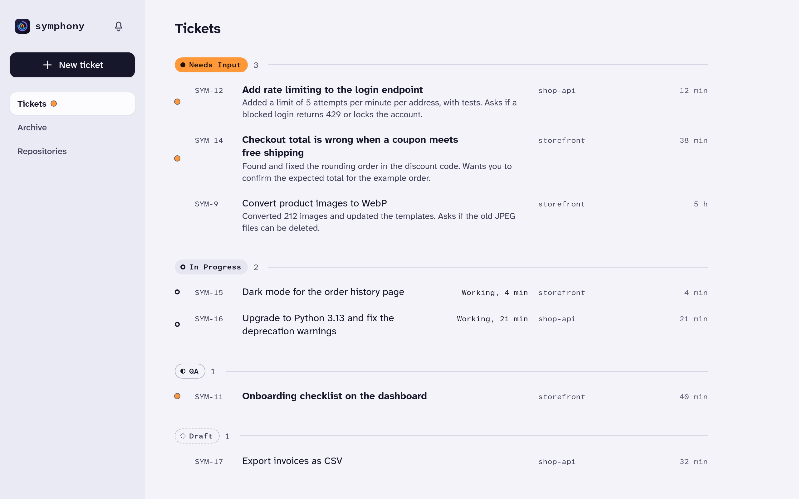
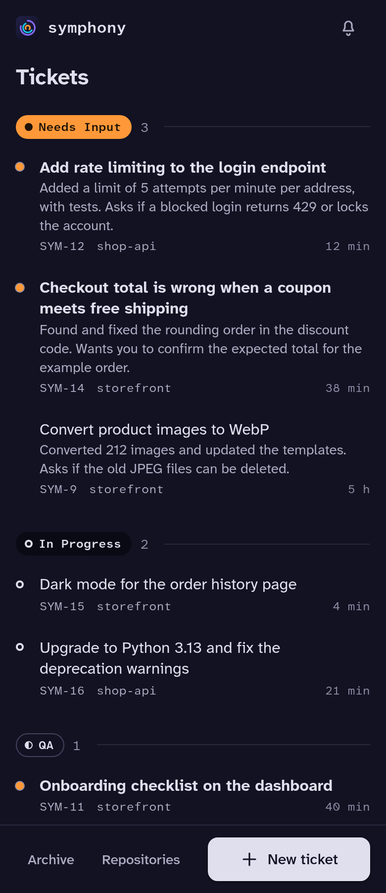
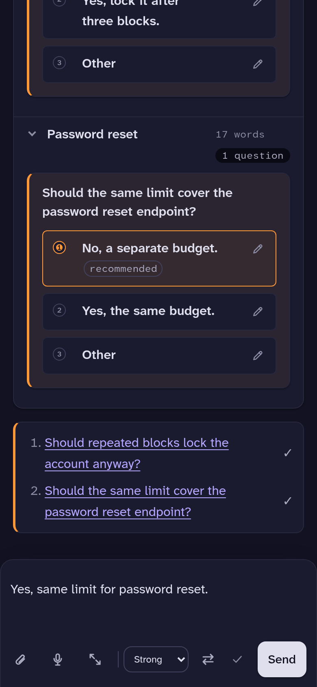
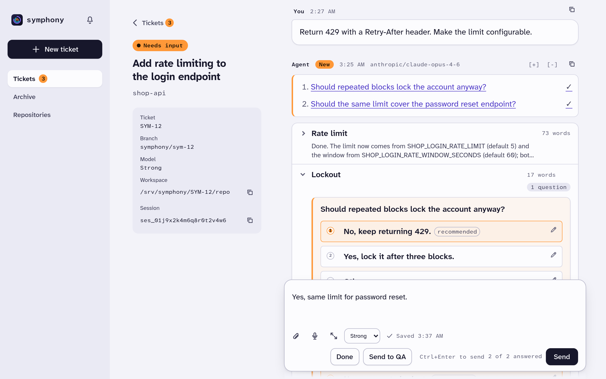

<p align="center"></p>

# Symphony

**A self-hosted web UI that runs your coding agent on tickets, in a sandbox,
on your own machine.**

Write a ticket, press Start, and walk away. Symphony clones the repository,
runs [OpenCode](https://opencode.ai/), OMP or pi on it inside a
[bubblewrap](https://github.com/containers/bubblewrap) sandbox, and posts the
agent's reply on the ticket. Answer when you have a moment, from your desk or
your phone, and the agent continues the same session. Several tickets run at
the same time, so you can keep planning while the agents work.

<p align="center">
  
</p>

It is one small Python daemon. There is no database, no account and no cloud
service: a ticket is a JSON file in a directory you choose, and the agent is
the CLI you already use, with the login it already has.

## What you get

- **A thread for each task.** The ticket text is the prompt. The agent's reply
  arrives as a comment with rendered Markdown, and your reply resumes the same
  agent session with its full context.
- **Sandboxed turns.** Each turn runs in bubblewrap. It can write to the
  ticket's own checkout and to your tool caches, and the rest of the machine
  is read-only. Your SSH keys, the usual cloud credential directories,
  Symphony's own config and every other ticket are hidden.
- **Parallel work.** Up to five turns run at once, each in its own clone of
  the repository and, by default, on its own branch.
- **Your agent and your models.** Use OpenCode, OMP or pi. Give your models
  short names in the config and pick one per ticket from a dropdown.
- **Made for the phone.** The layout fits a small screen, the UI installs as
  an app, and once you turn notifications on, a push notification tells you
  when a ticket needs you.
- **Dictation.** Speak the ticket or the reply instead of typing it (needs a
  [Soniox](https://soniox.com) key).
- **Attachments.** Add screenshots and files to a ticket or a reply. Images go
  to the model as image input.
- **Titles and summaries.** With an Anthropic key, tickets get a title
  automatically, and each ticket that waits for you shows one line that says
  what the agent did and what it needs.
- **Light and dark.** The theme follows your system.
- **Autosave.** Drafts and half-written replies are saved on the server as
  you type, so you can start on one device and finish on another.
- **Manual QA.** If your repository has a `.symphony/serve` script, one
  button runs it in the sandbox, so you can try the agent's work before you
  accept it.
- **An API for agents.** A small JSON API with a built-in guide lets another
  agent file tickets, read the replies and answer them.

<p align="center">
  
  &nbsp;&nbsp;
  
</p>

## Setup

You need:

- Linux. The sandbox is bubblewrap, which is Linux only.
- Python 3.11 or later, `git`, and `bwrap` (`apt install bubblewrap`,
  `dnf install bubblewrap` or `pacman -S bubblewrap`).
- One coding agent, installed and logged in: OpenCode V2 (the default), OMP
  or pi.

Then make a directory for Symphony, put a four-line config in it with a
password of your own, and start the daemon:

```bash
mkdir ~/symphony && cd ~/symphony

cat > config.yaml <<'YAML'
webui:
  port: 8080
  username: admin
  password: change-me   # Choose your own.
YAML

uvx symphony-linear
```

Open <http://127.0.0.1:8080/> and log in with the username and password from
the config. Then:

1. Press **New ticket**.
2. In **Repository**, choose **Add a repository…** and type `owner/name` or a
   clone URL. Symphony remembers it for the next ticket.
3. Give the ticket a title, describe the task, and press **Start**.

The ticket moves to In Progress. When the agent finishes its turn, the ticket
moves to Needs Input and shows the reply. Reply to continue, or press **Done**.

<p align="center">
  
</p>

Some things to know:

- Symphony clones with your own git credentials, outside the sandbox. If
  `git clone` works in your shell, it works here, private repositories
  included.
- The work stays in the ticket's checkout, `~/symphony/SYM-1/repo` for the
  first ticket, on the branch `symphony/sym-1`. Push it yourself after you review it, or
  ask the agent to commit and push.
- To use OMP or pi, add `agent: omp` or `agent: pi` at the top of
  `config.yaml`.
- No `uv`? `pip install symphony-linear` installs the same `symphony-linear`
  command.

To keep the daemon running, see the `systemd` unit in
[Running Symphony](https://github.com/skorokithakis/symphony/blob/master/docs/running.md).
Every option is in
[Configuration](https://github.com/skorokithakis/symphony/blob/master/docs/configuration.md),
and every button is in the
[web UI guide](https://github.com/skorokithakis/symphony/blob/master/docs/web-ui.md).

### Use it from your phone

The quick start above listens on `127.0.0.1` only. To reach Symphony from
another device, put a reverse proxy with HTTPS in front of the port (Caddy,
nginx, Traefik and so on). Do not expose the plain HTTP port: the login is
HTTP Basic auth, which sends the password with every request. Use a long,
unique password: anyone who has it can start a coding agent on your machine.

HTTPS is also what makes the phone features work. Browsers allow app install,
push notifications and the microphone only on a secure page. The
[web UI guide](https://github.com/skorokithakis/symphony/blob/master/docs/web-ui.md)
has the proxy settings.

## Use Linear or GitHub Projects instead

Symphony started as a daemon for Linear, and it still works without its own
UI. One daemon uses one tracker: the web UI, Linear, or GitHub.

- **Linear.** Add the `Agent` label to an issue and move it to In Progress.
  Symphony works on it, posts the reply as a comment, and moves the issue to
  a Needs Input state. Your comment resumes the agent. See
  [Linear setup](https://github.com/skorokithakis/symphony/blob/master/docs/linear.md).
- **GitHub Projects.** Set the `Symphony` field of a project item to `on`
  and its Status to In Progress. The conversation happens in the issue's
  comments, and the Status field shows the state. See
  [GitHub setup](https://github.com/skorokithakis/symphony/blob/master/docs/github.md).

## About the sandbox

The sandbox gives the agent one writable checkout, writable cache
directories (`~/.cache`, `~/.local/share` and the agents' own state), and a
read-only view of the rest of your machine, with the usual credential
directories hidden. It protects you from an agent that makes a mistake: it
cannot edit another project, change your shell configuration or read your
SSH keys.

By default it does not stop the agent from using your GitHub login. The `gh`
credentials and your SSH agent stay reachable on purpose, so that the agent
can read issues and open pull requests. If you do not want that, add those
paths to `sandbox.hide_paths`, next to the default entries. The sandbox also
shares your network and runs as your user, so it is not a defence against an
agent that tries to get out.
[How it works](https://github.com/skorokithakis/symphony/blob/master/docs/how-it-works.md)
describes exactly what is and is not hidden.

## What it does not do

- It does not run on macOS or Windows.
- It does not show the agent's steps while it works. You see how long the
  turn has run, and the written reply when the turn ends.
- It does not let you steer a turn that is running. You can stop it, or wait
  and reply.
- It does not retry a failed turn by itself. The ticket comes back to you
  with the error and a Retry button.
- It does not combine trackers. Web UI tickets do not appear in Linear or
  GitHub, and the reverse.

The full list is in
[How it works](https://github.com/skorokithakis/symphony/blob/master/docs/how-it-works.md#limitations).

## Documentation

- [Web UI](https://github.com/skorokithakis/symphony/blob/master/docs/web-ui.md):
  ticket states, the reply box, repositories, models, attachments, titles,
  dictation, notifications, the agent API and the reverse proxy.
- [Configuration](https://github.com/skorokithakis/symphony/blob/master/docs/configuration.md):
  the annotated `config.yaml`, model names, per-repository setup scripts,
  secrets and manual QA.
- [Running Symphony](https://github.com/skorokithakis/symphony/blob/master/docs/running.md):
  install options, `systemd`, where to keep credentials, and troubleshooting.
- [How it works](https://github.com/skorokithakis/symphony/blob/master/docs/how-it-works.md):
  the pipeline, the sandbox and the limitations.
- [Linear setup](https://github.com/skorokithakis/symphony/blob/master/docs/linear.md)
  and
  [GitHub setup](https://github.com/skorokithakis/symphony/blob/master/docs/github.md).
- [Development](https://github.com/skorokithakis/symphony/blob/master/docs/development.md):
  how to run the tests and work on Symphony itself.

## License

MIT. See [LICENSE](https://github.com/skorokithakis/symphony/blob/master/LICENSE).
