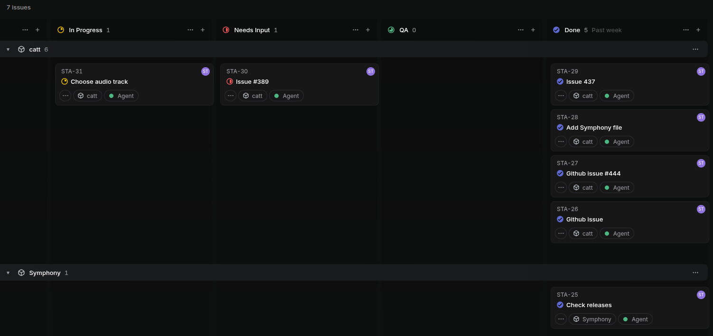
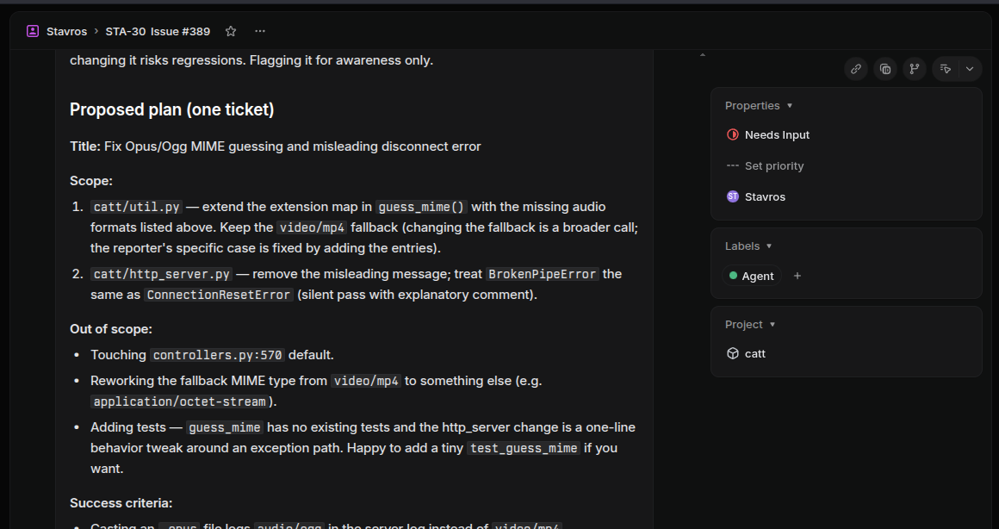

# Linear

<p>
  
  
</p>

This is the one-off plumbing that connects Symphony to your Linear workspace.
You do it once per workspace, plus a small per-repo step for each project
you want the agent to touch.

## Generate a Personal API key

Sign into Linear with the account you want the daemon to use. This can be
your own user account or a dedicated bot account — the daemon recognises its
own comments by the `*Symphony · …*` footer it adds to each one, not by user
identity, so a separate bot user is optional. Open **Settings** → **API** → **Personal API keys**,
create a key, and keep it somewhere safe; this is the value you'll supply
as `LINEAR_API_KEY`.

## Add a "Needs Input" workflow state

In your team's workflow settings, add a state called **Needs Input**.
Symphony moves tickets here when it finishes a turn and is waiting for you
to reply. You can rename this state later; the name lives in `config.yaml`.

## Create the trigger label

By default, add a label called **Agent** to the team. Any ticket carrying this
label becomes eligible for the agent, and the label name is configurable. The
daemon only looks at tickets in an active workflow state, so to start work,
add the label and move the ticket to **In Progress**.

This is optional: set `linear.trigger_label: null` to skip creating a trigger
label. In that mode, a ticket is eligible when it is in a configured active
state and its project has a **Repo** external link.

## Optional: a QA workflow state

If you'd like to manually exercise the agent's work, for instance by
clicking around a running web app, add a workflow state called **QA**, point
`linear.qa_state` at it in your config, and add a `.symphony/serve` script
to your repo. When you drop a ticket into that state the daemon runs your
serve script inside the sandbox. Details under [Manual QA](configuration.md#manual-qa).

## Per-repo: attach a Repo link

For each repository you want Symphony to work on:

1. Create a Linear project. Any team project will do; Symphony only uses it
   to find the repo URL.
2. In that project, open **Resources** and add a link with title `Repo`
   (case-insensitive) and the GitHub URL as the URL, for example
   `https://github.com/you/your-project`.

That link is how the daemon discovers which repo belongs to which ticket.

## Webhook (optional)

A webhook receiver cuts poll latency from up to `poll_interval_seconds` to
~1 second; polling continues as a safety net. The feature is opt-in — omit the
`webhook:` block to stay on polling only.

```yaml
webhook:
  port: 8080
  linear_secret: ${WEBHOOK_SECRET}
```

`linear_secret` is the HMAC-SHA256 signing secret. If the field is absent or
empty the daemon falls back to the `SYMPHONY_LINEAR_WEBHOOK_SECRET` environment
variable.

In Linear's UI: **Settings** → **API** → **Webhooks** → **Create webhook**.
Set the URL to `http://<your-host>:<port>/webhooks/linear/`, paste the same
signing secret, and subscribe to **Issue** and **Comment** events.

Symphony does not do TLS. Terminate TLS upstream (nginx, Caddy, Cloudflare)
if exposing the port publicly. Linear can deliver to either plain HTTP or
HTTPS, but production deployments should use HTTPS.
